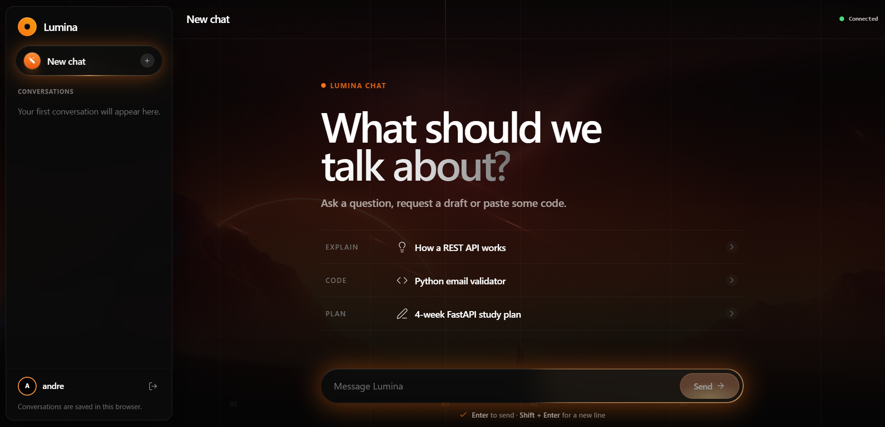
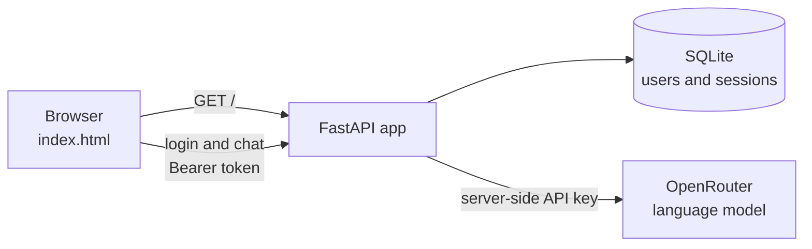

<div align="center">

# Lumina Chat

**A full-stack AI chat application with user accounts, built with FastAPI and framework-free JavaScript.**




</div>

## About

Lumina Chat is a ChatGPT-style conversation app. People create an account, sign in and talk to a language model through a polished interface with an animated WebGL background.

A single FastAPI application does all the work: it serves the page, manages accounts and sessions, and forwards messages to the model through [OpenRouter](https://openrouter.ai). The API key stays on the server and is never exposed to the browser.

The project was built to practice the whole path of a web product, from interface details such as motion and accessibility to backend concerns such as password storage, session handling and deployment readiness.

## Features

**Chat experience**
- Conversation history in a sidebar, with separate conversations for each account
- Follow-up questions that keep the context of the conversation
- Markdown responses with headings, lists, tables, quotes and code blocks
- One-click copy for messages and code
- Stop a response while it loads, or retry one that failed
- Clear messages for each failure: backend offline, model error, empty response or expired session

**Accounts and security**
- Sign up, sign in and sign out, with sessions that last 30 days
- Passwords hashed with Argon2id
- Chat endpoint protected, so only signed-in users can reach the model
- Sessions stored in the database, so signing out revokes access immediately

**Interface**
- Responsive layout for desktop and mobile
- Animated background with a WebGL aura and falling light beams
- Keyboard support: `Enter` to send, `Shift + Enter` for a new line
- Respects the operating system's reduced motion setting

## Tech stack

| Layer | Technology | Why it was chosen |
| --- | --- | --- |
| Backend | Python 3.14, FastAPI | Typed request validation and automatic API docs |
| Database | SQLite through SQLModel | One file and no server to maintain |
| Passwords | Argon2id through pwdlib | Memory-hard hashing, resistant to GPU attacks |
| AI | OpenRouter, using the OpenAI SDK | Access to many models through one API |
| Frontend | HTML, CSS and JavaScript | No framework and no build step |
| Design | Lumina design system, Lucide icons | Consistent tokens, components and motion |
| Tooling | uv | Fast, reproducible dependency management |

## Architecture



The page and the API share one origin, so the app needs no CORS configuration and no hardcoded API address.

## Engineering decisions

- **Sessions in the database instead of JWT.** Signing out really revokes access, and there is no signing secret to manage in production. Only the SHA-256 hash of each token is stored, so reading the database does not let anyone sign in as a user.
- **No clues for attackers at login.** A wrong password and an unknown username return the same response and run the same hashing work, so the endpoint does not reveal which usernames exist.
- **Short database connections.** The login check uses its own short-lived connection instead of holding one during the model call, which can take several seconds. A few simultaneous chats cannot exhaust the connection pool.
- **Safe rendering of model output.** The Markdown renderer is written by hand and escapes everything before building HTML, so nothing returned by the model reaches the page as markup.
- **Only public files are published.** The project folder also holds `.env` and the database, so the server exposes just the page and the design system assets, never the folder itself.
- **Database portability.** The connection comes from `DATABASE_URL`, so the app can move away from SQLite through configuration, without rewriting the data layer.
- **Context without changing the API.** The endpoint receives one message and keeps no history, so the frontend includes the 12 most recent messages as context.

## Getting started

### Prerequisites

- [uv](https://docs.astral.sh/uv/getting-started/installation/), which also installs the right Python version
- An [OpenRouter API key](https://openrouter.ai/settings/keys)

### Installation

**1. Clone the repository and install the dependencies**

```bash
git clone https://github.com/AndreLuiz-Cardoso/luminachat.git
cd luminachat/app
uv sync
```

**2. Create a file named `.env` inside the `app` folder**

```env
OPENROUTER_KEY=your-openrouter-key
```

**3. Start the application**

```bash
uv run fastapi dev main.py
```

**4. Open [http://127.0.0.1:8000](http://127.0.0.1:8000) in your browser**

The database and its tables are created automatically the first time the app starts.

> If `uv sync` fails with a certificate error, which can happen behind a corporate proxy or antivirus, run `uv sync --native-tls`.

## How to use

1. On the sign-in screen, select **Create account** and choose a username and a password.
2. Type a message and press `Enter`, or select one of the suggested prompts.
3. Keep talking: follow-up questions use the context of the conversation.
4. Select **New chat** to start another conversation. Previous ones stay in the sidebar.
5. To delete a conversation, hover over it, select the trash icon and confirm.
6. To sign out, use the icon next to your name at the bottom of the sidebar.

## API reference

| Method | Route | Access | Description |
| --- | --- | --- | --- |
| `GET` | `/` | Public | Serves the chat interface |
| `POST` | `/register` | Public | Creates an account and returns a session token |
| `POST` | `/login` | Public | Signs in and returns a session token |
| `POST` | `/logout` | Token | Ends the current session |
| `GET` | `/me` | Token | Returns the signed-in user |
| `POST` | `/send_message` | Token | Sends a message to the model and returns its reply |

Protected routes expect the header `Authorization: Bearer <token>`. With the app running, interactive documentation is available at [http://127.0.0.1:8000/docs](http://127.0.0.1:8000/docs).

## Configuration

| Variable | Required | Description |
| --- | --- | --- |
| `OPENROUTER_KEY` | Yes | API key used to call the model |
| `DATABASE_URL` | No | Database connection. Defaults to the SQLite file `app/lumina.db` |

## Project structure

```text
luminachat/
├── Print.png                        # Screenshot used in this README
└── app/
    ├── main.py                      # Application, chat endpoint and page delivery
    ├── autenticacao.py              # Accounts, sessions and password hashing
    ├── banco.py                     # Database connection and tables
    ├── pyproject.toml               # Dependencies
    └── frontend/
        ├── index.html               # The whole interface: HTML, CSS and JavaScript
        └── lumina-video-design-system/   # Design system reference and assets
```

## Current limitations and roadmap

This project is under active development. These are the known gaps and the next steps:

- [ ] Rate limiting on sign-in, sign-up and chat
- [ ] Invite-only registration, since sign-up is open to anyone who can reach the app
- [ ] Automated test suite in the repository
- [ ] Streaming responses, which currently appear all at once
- [ ] Conversations stored on the server, which currently stay in the browser of each device
- [ ] Password recovery
- [ ] Database migrations with Alembic
- [ ] Validation against a live PostgreSQL server
- [ ] Production deployment with Docker

## Author

Built by **André Cardoso**. Find more projects on [GitHub](https://github.com/AndreLuiz-Cardoso).
